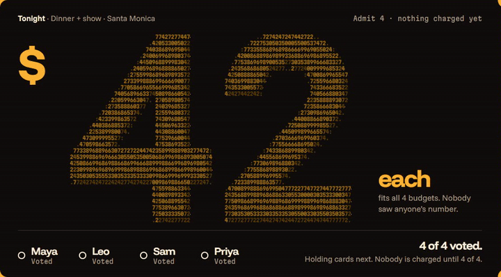
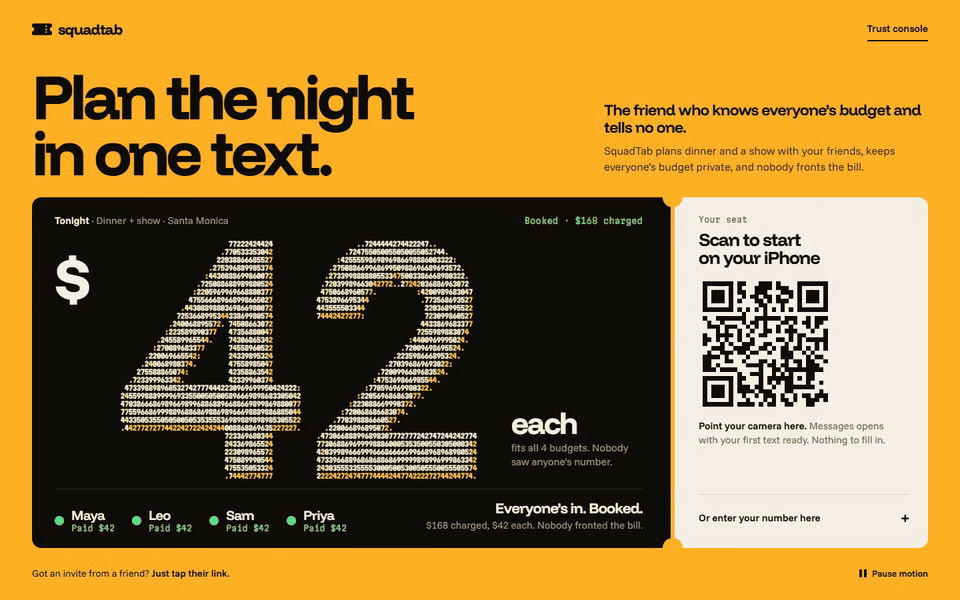
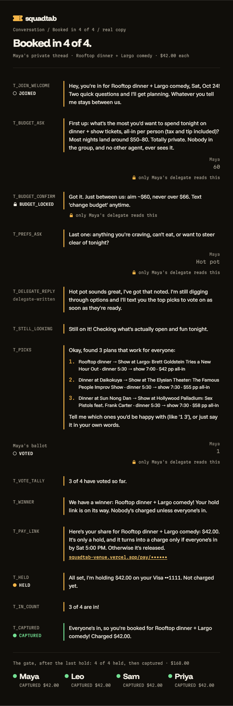
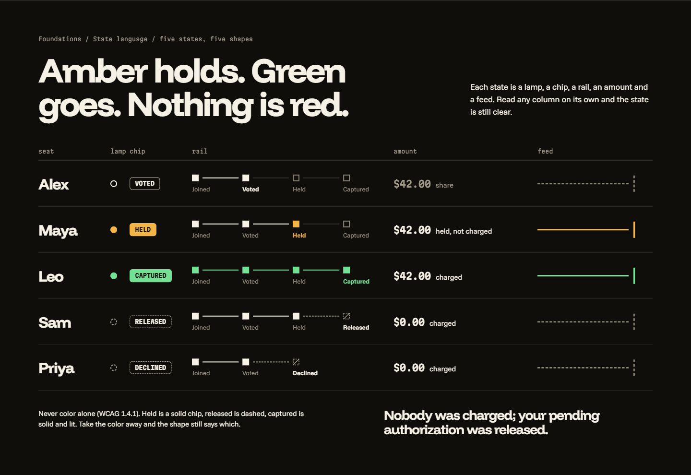
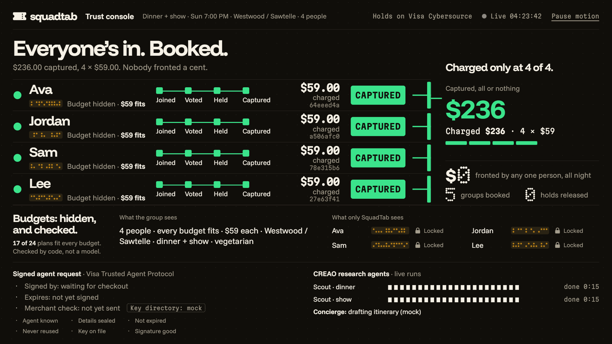
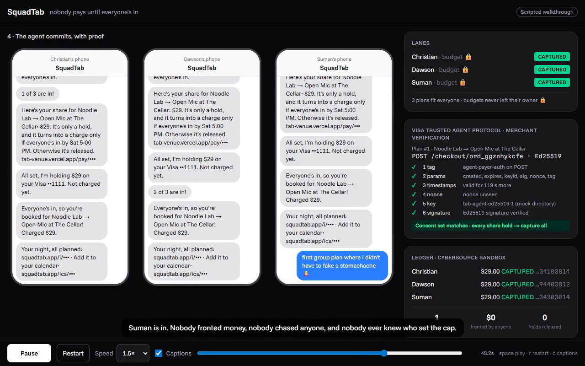
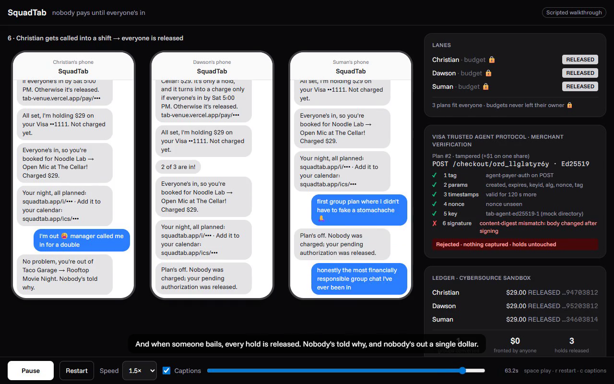
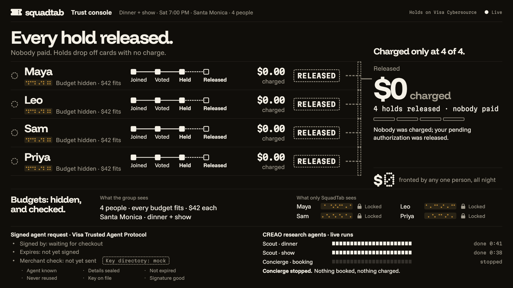
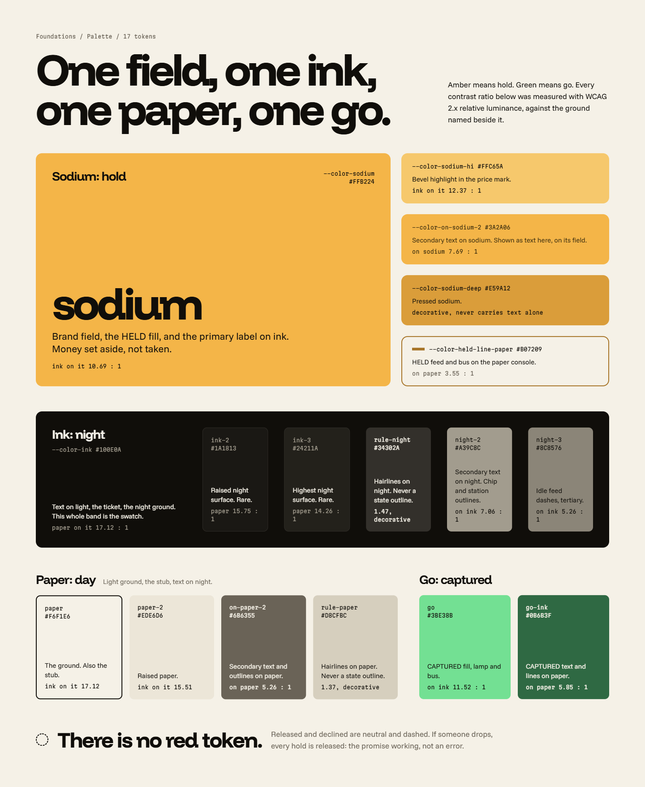

<div align="center">


# SquadTab

**The friend who knows everyone's budget and tells no one.**

Everyone texts SquadTab privately in iMessage. A CREAO agent finds real dinners and shows, plain code keeps only the plans *everyone* can afford, each friend holds only their own share on a Cybersource card page, and a signed Visa Trusted Agent Protocol commit captures every share at once, or releases them all.


*Say no without saying why · Nobody pays until everyone's in · Privacy you can test*

[](https://youtu.be/fHh89lb2DWY)

**[▶️ Watch the demo](https://youtu.be/fHh89lb2DWY)** · **[Try it live](https://tab-web-ten.vercel.app)** · **[Partner venue](https://squadtab-venue.vercel.app)** · **[Paper design file](https://app.paper.design/file/01M57RY01PHZA13NV3SS3NQN5N)**

<sub>LA Hacks AI Hackathon 2026 · Track: Applied Intelligence · Photon · CREAO · Visa · Paper</sub>

</div>

---

## ⚡ The idea

Every friend group has a dead plan sitting in its chat. It dies at one of two moments:

1. **Someone has to say "I can't afford that"** in front of everyone. Nobody does, and the quiet friend silently drops out.
2. **Someone fronts the money**, then spends two weeks chasing payment requests. According to Zelle research (June 2026), **76% of Gen Z consumers who fronted money for a group expense say they were not fully repaid.**

Both are the same problem: **money talk only works in private.** So SquadTab never joins your group chat, on purpose. Each friend talks to their own private delegate, a mechanism made of plain code sits between them, and the purchase happens only when every share is held.

> **Nobody fronts. Nobody chases. Nobody ever learns who set the cap.**

<div align="center">

<br/><sub>The price is "$42 each", drawn in tiny re-rolling digits. Those are everyone's private budgets. You'll never read one.</sub>
</div>

## 🔁 How it works

| # | Stage | What happens |
|---|---|---|
| 1 | **Start** | The organizer starts a plan on the web or by text and pastes one link into the group chat. |
| 2 | **Private DMs** | Each friend texts SquadTab in a **private iMessage DM** (Photon 2.0): *"I can do sixty, and I'm craving hot pot."* Only that friend's own delegate (Claude, no tools) ever hears it. |
| 3 | **Research** | **SquadTab Scout**, a CREAO agent, researches real dinners and shows open that night, validates its own output against our schema and submits. |
| 4 | **Fair shortlist** | Plain code prices every bundle, drops anything over *anyone's* cap, and picks three fair options. It never says whose budget ruled something out. |
| 5 | **Private vote** | Friends vote from their own DMs. There's one price, the same for everyone. |
| 6 | **Hold, not charge** | Each friend holds only their own share on the partner venue's Cybersource Microform page. |
| 7 | **Signed commit** | At N of N held, the agent signs the exact deal with the **Visa Trusted Agent Protocol**. The venue verifies six steps against its own database and captures every share at once. |
| 8 | **Or release** | One "I'm out" releases everyone: *"Nobody was charged; your pending authorization was released."* |
| 9 | **Concierge** | **SquadTab Concierge**, our second CREAO agent, writes the itinerary and a calendar file. |

**The only privacy claim we make:** only your own agent hears your budget. CREAO, the group messages and everyone else's agent never get it, and every money decision is plain code.

## 🖼️ The product

<div align="center">

<br/><sub><b>Start a plan.</b> The plan is a ticket; the stub is the QR that opens iMessage on your phone.</sub>
</div>

<br/>

<table>
<tr>
<td width="42%" valign="top"></td>
<td valign="top">
<b>The conversation is the interface.</b> One friend's private thread, from join to captured, with our real message copy. Budgets, preferences and ballots stay inside that friend's own delegate (🔒). Every money and privacy message is a fixed template, never model-written.
<br/><br/>

<br/><sub>Signal's state language: amber means held, green means captured, and there is no red. A drop-out is the promise working, not an error.</sub>
</td>
</tr>
</table>

<div align="center">

<br/><sub><b>Trust Console, booked.</b> Four lanes captured, every budget shown only as a lock, the Visa TAP verification panel and the live CREAO runs.</sub>
</div>

<br/>

<table>
<tr>
<td width="50%"></td>
<td width="50%"></td>
</tr>
<tr>
<td><sub><b>The commit, with proof.</b> TAP 6/6 at the merchant, the consent set matches, and every share is captured.</sub></td>
<td><sub><b>Tamper with one share by $1</b> and the content digest no longer matches: rejected, nothing captured. When someone bails, every hold is released.</sub></td>
</tr>
</table>

<sub>The two frames above come from the venue's scripted walkthrough (`/demo`). The live flow runs on real phones, as shown in the video.</sub>

<div align="center">

<br/><sub><b>Released.</b> Someone dropped, so every hold is released and nobody is named.</sub>
</div>

## 🏗️ Architecture

```text
iMessage DMs ──Photon 2.0──▶ Agent (TypeScript · Hono · Fly.io)
                              ├─ one private delegate per friend (Claude, no tools, sees one person only)
                              ├─ plan state machine + fixed money/privacy message templates
                              ├─ compose → filter → score → pick   (pure code, not callable by any model)
                              ├─ CREAO Scout + Concierge  (API runs, webhook re-fetch, 15 s polling)
                              └─ TAP signer (Ed25519) ──signed request──▶ Partner Venue (Next.js · Vercel)
                                                                           ├─ prices every order itself
                                                                           ├─ Cybersource Microform pay page
                                                                           ├─ 6-step TAP verifier + nonce store
                                                                           └─ all-or-nothing capture / release

Trust Console (Next.js): lanes · context X-ray (budgets always 🔒) · CREAO lane · TAP panel · ledger
Supabase Postgres: separate schemas and roles for the agent and the venue
```

## 🧮 The math

**One price, computed by the merchant.** With dinner estimate d, show estimate s, tax τ = 0.1025 and tip θ = 0.18, every friend pays

$$P = \left\lceil\, d\,(1+\tau+\theta) + s\,(1+\tau) \,\right\rceil \qquad T = n \cdot P$$

The venue computes P and T itself. No amount is ever accepted from a model, a URL or a request body.

**A private filter no model can call.** Each friend's cap is cᵢ = hᵢ (their hard max) or round(1.1 · tᵢ) from their target. A bundle survives only if

$$P_b \le \min_i c_i$$

It's one comparison inside a pipeline step, not a tool, which blocks anyone binary-searching a friend's budget by asking an AI "would 41 work? 39?".

**Fair, not loudest-wins.** Each delegate rates each bundle (rᵢ,b between 0.05 and 1), with price comfort κᵢ easing down past a friend's target:

$$\kappa_i(P) = \begin{cases} 1 & P \le t_i \\ \max\!\left(0.6,\; 1 - 0.4\,\dfrac{P - t_i}{\max(1,\; c_i - t_i)}\right) & P > t_i \end{cases} \qquad W(b) = \sum_{i=1}^{n} \ln\!\big(r_{i,b}\cdot \kappa_i(P_b)\big)$$

Summing logs multiplies everyone's satisfaction, so no one person can be sacrificed for the rest. The shortlist is the top three by W with no shared dinner or show; the private vote picks the winner.

**All or nothing, provably.** The merchant captures only when

$$\text{TAP}_{\text{valid}} \;\wedge\; \forall i:\ \text{status}_i = \text{AUTHORIZED} \;\wedge\; \sum_i a_i = T \;\wedge\; \text{body} = \text{canon}(\text{DB})$$

**The TAP commit.** The agent signs an RFC 9421 signature base over the method, host, path and a digest of the deal, and the venue checks tag, fields, time window, nonce, key and signature, recomputing

$$D = \text{SHA-256}\big(\text{canon}(\text{order},\; T,\; \{(\text{share}_i,\ \text{authId}_i,\ a_i)\})\big)$$

from **its own database**. Change one share by a dollar after signing and step 6 fails. Nonces work once, and pay links are 128-bit single-use tokens.

## 🏆 Built for each challenge

### Applied Intelligence

AI does what it's good at: understanding one person's natural-language budget and taste, and researching the open world. It stays out of everything it must not be trusted with. **No LLM has tools**, there is **no group-coordinator LLM**, the fair filter is a pipeline step no model can call, and every number that moves money comes from code and the venue's database. Privacy is enforced by context isolation and a **build-failing test**, not by a prompt.

### Photon: iMessage on Photon 2.0

- **Live on iMessage** through Photon 2.0 Beta shared lines (`@photon-ai/api` 0.5.0). Text it from your own phone via the [live web](https://tab-web-ten.vercel.app).
- **Craft:** typing indicator during long research runs, mark-as-read, an idempotency key on every send, and a persisted Socket.IO replay cursor so no message is lost across deploys. A production message reached a team phone in 2.2 s; replies take about 1–4 s.
- **Depth:** the shared-line rules (user texts first, DM-only, no threaded replies) shaped the whole private-DM design. Edges stay truthful: "I'm out" after booking gets an honest too-late reply, and a budget-blocked plan asks for a recovery instead of failing silently.
- Code: [`apps/agent/src/photon/`](apps/agent/src/photon)

### CREAO: AI-First Disruptor

**Remove the agent and SquadTab has nothing to vote on.** Scout produces every option; Concierge produces the itinerary and calendar file.

| Agent | Agent ID | Run |
|---|---|---|
| **SquadTab Scout** | `1b834601-b727-40aa-b80d-7e7d1c0cabe0` | [share link](https://agent.creao.ai/share/12ea3fa0f9699dabe5175e2cb6eadc28) |
| **SquadTab Concierge** | `465a1d2e-a46f-496c-adea-fc471a396a6c` | [share link](https://agent.creao.ai/share/6d95ca9660e15924b0f91c5e19e19894) |

- **API Trigger:** runs start with `POST /api/v1/runs` and an idempotency key. Webhooks are unsigned, so each one only triggers a re-fetch of the run, backed by a 15 s poll.
- **Our own skill and CLI:** [`skills/tab`](skills/tab) is saved with both agents. Inside a run the agent writes `options.json`, runs `tab options validate`, fixes the exact reported paths (up to 5 rounds) and submits, while `tab progress` streams into the console's CREAO lane.
- **Real output:** live Scout runs returned 12 real dinners and 12 real shows with dated showtimes; Concierge returned an itinerary and a correct calendar file.
- **Privacy:** CREAO only ever sees a `ResearchBrief` (enums, area, date, times, party size). The account `capi_` key stays on our server.

### Visa: The Future of Shopping

Agent shopping today is one person, one card. **Groups are the unsolved case.** SquadTab turns a group purchase into an assurance contract at the merchant of record: N cardholder-initiated authorizations, plus one identified agent that can commit only the exact consent set.

- **Real Cybersource sandbox calls:** authorization (`capture:false`), capture, reversal and timeout reversal, with card data only inside Microform v2 iframes and one-tap saved cards through TMS.
- **Exactly-once without an idempotency header:** unique `(share_id, op, attempt)` records, deterministic reference codes, persisted transaction IDs and no blind auth retries.
- **Trusted Agent Protocol:** our own Ed25519 RFC 9421 signer ([`apps/agent/src/tap/`](apps/agent/src/tap)) and six-step verifier at the merchant ([`apps/venue/src/tap/verify.ts`](apps/venue/src/tap/verify.ts)).
- **Verified:** real holds and captures (a team phone test captured \$137), TAP 6/6 on a real commit, Tamper, Replay, Expired and Wrong-tag each rejected with nothing captured, and releases.
- **Side quest:** our provisioned sandbox merchant failed every authorization. We pulled the processor records, found reason 150 on `fdiglobal` with the USD outlet and terminal IDs missing, reported it, and Cybersource Level II updated the merchant during the hackathon. The venue switches merchants by environment variables alone, so the demo runs on Cybersource's public test merchant (`testrest`).

### Paper: Best Designed Hack

Our design system is **Signal**: SquadTab works like a traffic signal for a group plan, and the plan is a ticket. Designed in the [Paper file "SquadTab"](https://app.paper.design/file/01M57RY01PHZA13NV3SS3NQN5N).

<div align="center">

</div>

- **Hierarchy:** the ticket is the hero, and its price is the largest thing on every screen.
- **Type:** Funnel Display, Funnel Sans and Martian Mono (amounts and codes), each with one job.
- **Consistency:** 30 tokens in Paper; all 17 colors and the radii are identical to production `globals.css`, shared by the web app and the venue's pay page.
- **Contrast, measured:** 38 state pairs, 0 failing WCAG; ink on sodium amber `#FFB224` is 10.69:1. States also differ by shape (solid, outline, dashed), never by color alone.
- **Character:** sodium-vapor amber is the color of going out at 1 a.m., and in signaling it already means hold. Our written anti-AI rules ban gradients, glows, pills, bento grids, emoji and stock icon sets; our icons are 7×7 dot glyphs.
- **Process:** we critiqued our own designs (14 findings, each with what changed and where it's verified), ran a second review and fixed every P0.
- Spec: [`docs/design/design-system.md`](docs/design/design-system.md) · Flow and copy: [`docs/design/ux-flow.md`](docs/design/ux-flow.md)

## 🔒 Privacy and money invariants

Each one has a test (`pnpm test`).

1. Budgets live only in `app.private_constraints`, readable only by that person's own delegate, the filter/score step and `holdGate`.
2. A delegate sees only its own person's messages and state. There's no group-coordinator LLM.
3. No LLM ever has tools. The filter is a pipeline step, never a callable.
4. Money and privacy messages are fixed templates sent through one function (`notify`).
5. CREAO inputs are a `ResearchBrief` only.
6. `app.events` and SSE never carry constraint values; the console shows each delegate as a lock.
7. Cybersource credentials, TMS tokens and card data live only in `apps/venue`.
8. Amounts always come from the venue database via `priceBundle()`.
9. Capture happens only after a TAP-verified commit whose body equals the consent set rebuilt from the database, with every share authorized.
10. Exactly-once money: unique attempts, deterministic reference codes, persisted transaction IDs, timeout reversal, no blind auth retries.

[`apps/agent/test/privacy.e2e.test.ts`](apps/agent/test/privacy.e2e.test.ts) seeds odd budgets (\$31.17, \$47.29, \$63.43, \$88.61, …) and **fails the build** if any appears in another person's delegate call, a CREAO input, a group text, `app.events`, SSE frames, logs or venue requests.

## 🧰 Tech stack

| Layer | Technology |
|---|---|
| Agent | TypeScript · Node 22 · Hono 4 on Fly.io |
| Web + venue | Next.js 16 · React 19 · Tailwind CSS 4 on Vercel |
| Messaging | Photon 2.0 Beta (`@photon-ai/api`) · Socket.IO |
| AI | Anthropic Claude (Haiku 5.5 for parsing, Sonnet 5.5 for ratings) · CREAO agents |
| Payments | Cybersource REST · Microform v2 · TMS · Visa Trusted Agent Protocol (RFC 9421, Ed25519) |
| Data | Supabase Postgres, separate schemas and roles for agent and venue |
| Quality | Zod 4 contracts · Vitest, 1,500+ automated tests |
| Design | Paper |

## 🚀 Run locally

Requirements: Node 22.12+, pnpm 10.21.0.

```bash
pnpm install
cp .env.example .env.local   # mock modes work without any keys
pnpm dev                     # agent :8080, web :3000, venue :3001
pnpm sim:plan                # a full mocked plan through POST /dev/inbound
pnpm test                    # privacy e2e, TAP verify, state-machine races and more
pnpm typecheck
```

`pnpm db:migrate` applies `db/migrations/*.sql`, and `pnpm seed:demo` creates a demo plan with cached options.

## 🗂️ Project structure

```text
SquadTab/
├── apps/
│   ├── agent/      # Photon, router, private delegates, plan state machine, decide/, money/, CREAO, TAP signer, jobs
│   ├── venue/      # partner venue: pricing, Microform pay page, TAP verifier, Cybersource
│   └── web/        # landing, create + join pages, Trust Console (SSE)
├── packages/shared # Zod contracts, message templates, pricing, TAP helpers
├── skills/tab      # the tab CLI, schemas and SKILL.md used inside CREAO runs
├── db/             # migrations and roles
└── docs/           # PLAN, EXPLAINER, VERIFICATION, design/
```

## ✅ What's real

- **Real:** Photon 2.0 live iMessage DMs; two CREAO agents doing the research and the itinerary; Cybersource sandbox holds, captures and reversals; our Ed25519 RFC 9421 TAP signer and six-step verifier; the build-failing privacy test.
- **Sandbox:** payments run on Cybersource's public test merchant with test cards only, no real money. "SquadTab Partner Venue" is our own demo merchant of record selling a prepaid dinner + show bundle.
- **Labelled mock:** the TAP key directory ("Key directory: mock" on screen). The venue's `/demo` page is a scripted walkthrough.

## 🙏 Team

Built in 24 hours at LA Hacks AI 2026 by [@cibarbia05](https://github.com/cibarbia05), [@L00SIRE](https://github.com/L00SIRE) and teammates.

Built with Photon · CREAO · Anthropic Claude · Cybersource + Visa Trusted Agent Protocol · Supabase · Fly.io · Vercel · Paper.

<div align="center">
<br/>
<sub><b>SquadTab</b> · say no without saying why. Nobody pays until everyone's in.</sub>
</div>
