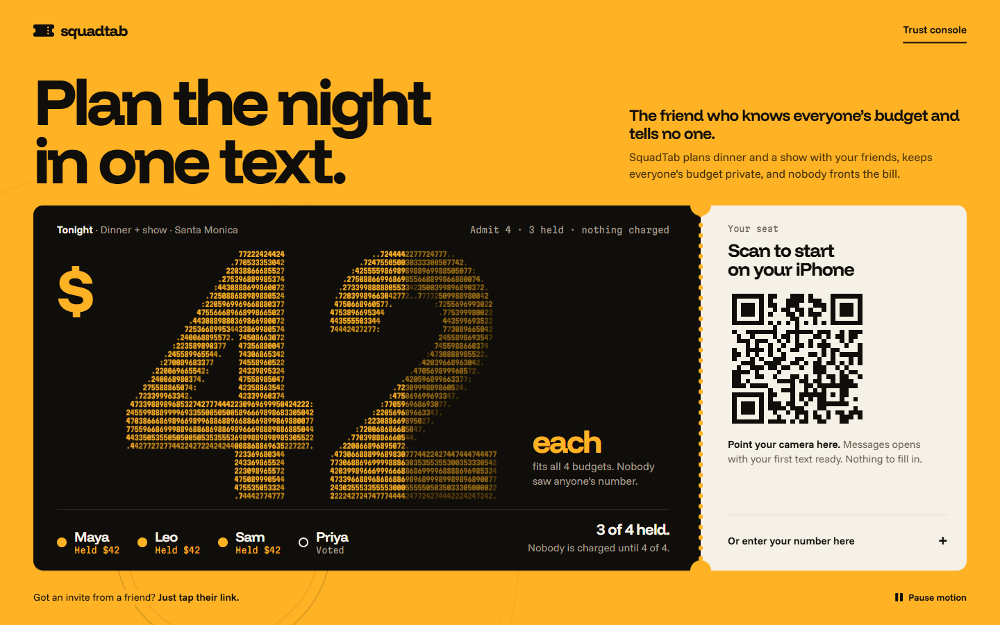

# SquadTab

**The friend who knows everyone's budget and tells no one. It finds the plan you can all afford, and nobody pays until everyone's in.**

*Say no without saying why. Nobody pays until everyone's in.*

| | |
|---|---|
| Live web (start a plan, join) | https://tab-web-ten.vercel.app |
| Trust Console | `https://tab-web-ten.vercel.app/console`. It needs a key, so ask us at the table for a live view. |
| Partner venue (Cybersource sandbox, public test merchant) | https://squadtab-venue.vercel.app (`tab-venue.vercel.app` is the simulated build; don't use it) |
| Agent backend | https://tab-agent.fly.dev/healthz |
| Demo video | [DEMO VIDEO] |
| Design (Paper file "SquadTab") | https://app.paper.design/file/01M57RY01PHZA13NV3SS3NQN5N (fallback while link sharing is being enabled: [PAPER SHARE LINK]) |
| Devpost | [DEVPOST LINK] |

LA Hacks AI Hackathon, UCLA, Oct 17-18, 2026. **Track: Applied Intelligence.** Company challenges: Photon (iMessage), CREAO AI-First Disruptor, Visa "The Future of Shopping", and Paper Best Designed Hack. All code was written during the hackathon window (Sat 12:00 PM to Sun 12:00 PM PDT).



## Why

> According to Zelle research (June 2026), 76% of Gen Z consumers who have fronted money for a group expense, like a trip or event, say they were not fully repaid.

Group plans die at two awkward moments. Someone has to say "I can't afford that" in front of everyone, or someone fronts the money and then chases friends to get paid back. SquadTab removes both: budgets stay private, and the purchase happens only when every friend's share is held.

## How it works

1. The organizer starts a plan and pastes one link into the group chat.
2. Each friend talks to SquadTab in a **private iMessage DM** (Photon). SquadTab never joins the group chat, on purpose: money talk only works in private.
3. A private delegate per friend (Claude, no tools) takes that friend's budget and confirms it back to them only.
4. **SquadTab Scout**, a CREAO agent, researches real dinner spots and shows that are open that night.
5. Plain code pairs them, drops anything over anyone's cap, and picks a fair three. It never says whose budget ruled something out.
6. Friends vote privately. Each one authorizes only their own share as a card **hold** (Cybersource Microform) on the partner venue's pay page.
7. When every share is held, the agent signs one commit (Visa Trusted Agent Protocol). The venue verifies it and captures. If anyone drops, every hold is released: "Nobody was charged; your pending authorization was released."
8. After booking, **SquadTab Concierge** (a second CREAO agent) builds the itinerary and a calendar file.

```
 Friends' iPhones --private iMessage DMs--> Photon 2.0 shared lines
                                                 | Socket.IO in (replay cursor) / REST out
                                                 v
 apps/agent (Hono, Fly.io)
   one private delegate per person (Claude, no tools)   plan state machine   fixed templates
   decide/: compose -> filter -> score -> pick (pure code)   money/holdGate
   CREAO client (API Trigger, webhook = hint, re-fetch + 15 s poll)
   TAP signer (Ed25519, RFC 9421)
      |  research brief only            ^ tab CLI: progress,           | signed HTTPS (TAP)
      v                                 | options, itinerary           v
 CREAO: Scout, Concierge ---------------+          apps/venue (Next.js, Vercel)
                                                     prices from its own DB, 6-step TAP verifier,
 apps/web (Next.js, Vercel)                          Microform pay page
   create, join, Trust Console (SSE, no budgets)            |
                                                            v
 Supabase Postgres: schema app (agent) | schema venue   Cybersource sandbox: hold, capture, release
```

## For judges: where to verify each prize

| Prize | Verify in 5 minutes |
|---|---|
| Applied Intelligence | [Privacy and money invariants](#privacy-and-money-invariants); `apps/agent/test/privacy.e2e.test.ts`; `apps/agent/src/decide/` |
| Photon | Text it from your own phone (join at the live web link); `apps/agent/src/photon/` |
| CREAO | Agent IDs and run share links in [CREAO](#creao-ai-first-disruptor); `skills/tab/`; `apps/agent/src/creao/` |
| Visa / Cybersource + TAP | https://squadtab-venue.vercel.app; `apps/venue/src/tap/verify.ts`; `apps/venue/test/tap.e2e.test.ts`; `apps/agent/src/tap/signer.ts` |
| Paper Best Designed Hack | The Paper file; [Design: Signal](#paper-best-designed-hack-design-signal); `docs/design/design-system.md` |

### Applied Intelligence (main track)

The official track text wasn't in our copy of the rules, so this section uses the LA Hacks judging criteria.

- **Technical depth:** one isolated delegate per person, with no group-coordinator LLM. The fair filter is a pipeline step that no model can call. Exactly-once capture is race-tested (`apps/agent/src/plan/races.test.ts`), and the TAP signer and verifier are our own.
- **Product thinking and impact:** the problem is sharp (the Zelle stat above). We flip the order Venmo and Splitwise use: private limits first, then holds, then one purchase only at N of N. Nobody fronts and nobody chases.
- **Originality and insight:** money talk is a privacy problem first. AI handles what it's good at (understanding a person's budget and taste, researching the open world). It stays out of what it can't be trusted with: every number that moves money comes from code and the venue's database.
- **Execution and polish:** live on iMessage, on Cybersource sandbox and on CREAO, with 1,500+ automated tests and a designed system (Signal) across web, console, pay page and the conversation itself.

### Photon (iMessage)

Built on **Photon 2.0 Beta** (`@photon-ai/api` 0.5.0) and **live on iMessage** through Photon's shared lines.

- **Vision (hybrid intelligence):** a private delegate per friend, a code mechanism between them, and humans keep every yes. The DM is the product: there's no app to install and no group app.
- **Craft:** a typing indicator during long research runs, mark-as-read, an idempotency key on every send, and a persisted Socket.IO replay cursor, so no message is lost across deploys. We use plain text only: polls, tapbacks and effects aren't in the 2.0 iMessage content union, and shared lines reject threaded replies.
- **Depth (real-world context and edge cases):** shared-line rules (the user texts first, DM-only) shaped the whole private-DM design. Edge cases get truthful replies: "I'm out" after booking gets an honest too-late reply, and a budget-blocked plan asks the member to recover instead of failing silently.
- **Traction:** judges join from their own phones through the web join page, and the backend assigns them a line.

### CREAO: AI-First Disruptor

**Remove the agent and SquadTab stops working.** Scout produces every option the group can vote on, so without it there's nothing to vote on. Concierge writes the itinerary and calendar file after checkout (a plain code-built itinerary is only the labelled timeout fallback).

| Agent | Agent ID | Run share link | Core work |
|---|---|---|---|
| **SquadTab Scout** | `1b834601-b727-40aa-b80d-7e7d1c0cabe0` | https://agent.creao.ai/share/12ea3fa0f9699dabe5175e2cb6eadc28 | Researches the open web for real dinners and shows (open-at-time evidence, start times, dietary fit, price evidence). It validates its own output against our schema, fixes it and submits. |
| **SquadTab Concierge** | `465a1d2e-a46f-496c-adea-fc471a396a6c` | https://agent.creao.ai/share/6d95ca9660e15924b0f91c5e19e19894 | After booking: the itinerary (parking, doors time, dress code) and a calendar file. |

- **AI as foundation:** the agents do the research and the post-purchase logistics. Our code only filters and scores what Scout finds.
- **API Trigger:** `apps/agent/src/creao/client.ts` starts runs with `POST /api/v1/runs {appId, inputs, webhookUrl, idempotencyKey}`. Webhooks are unsigned, so `/creao/hook/:secret` is only a hint: we dedupe, then re-fetch `GET /runs/{id}`, and we also poll every 15 s.
- **Our own skill and CLI:** [`skills/tab`](skills/tab), a public SKILL.md plus a python3 `tab` CLI (`ping`, `progress`, `schema`, `options validate|submit`, `itinerary submit`) saved with both agents. Inside a run the agent writes `options.json`, runs `tab options validate`, fixes the exact reported paths (up to 5 rounds), then submits. `tab progress` lines stream into the console's CREAO lane.
- **Secrets:** CREAO Secrets hold only `TAB_API_BASE` and a narrow `TAB_AGENT_TOKEN` that reaches three endpoints (progress, options, itinerary). The account `capi_` key stays on our server.
- **Privacy:** CREAO receives only a `ResearchBrief` (enums, area, date, times, party size), with no names, phones, budgets or free text (`apps/agent/src/creao/brief.ts`).
- **See it run:** open the run share links above, and watch the Trust Console's CREAO lane during the demo: `tab progress` lines stream in while Scout researches, and the run is labelled **live** or **cached**.
- **Fallbacks, stated out loud:** Scout times out at 6 min and Concierge at 10 min. On timeout the plan uses a real earlier Scout snapshot or a code-built itinerary, and the console labels every run **live** or **cached**.

### Visa: The Future of Shopping (Cybersource + Trusted Agent Protocol)

A group purchase becomes an assurance contract at the merchant of record: N cardholder-initiated authorizations, plus one identified agent that can commit only the exact consent set.

- **Innovation (25%):** nobody fronts. Each friend holds only their own share, and capture happens only at N of N.
- **User experience (25%):** you pay your share from a DM, as a hold, not a charge. Amber means held and green means captured. There's no red: a drop-out releases everyone, which is the promise working.
- **Technical execution (20%):**
  - Real Cybersource sandbox calls: authorization with `capture:false` plus token creation, capture, reversal and timeout reversal.
  - Cybersource has no idempotency header, so we use unique `(share_id, op, attempt)` records, deterministic reference codes, persisted transaction ids and no blind auth retries.
  - Our own Ed25519 RFC 9421 signer and a six-step verifier: the right tag for the route, required fields, an 8-minute window, a single-use nonce, a known key, and a signature over a content digest of the consent set rebuilt from the venue database.
- **Commerce impact (15%):** it covers discovery (CREAO), decision (private ballot, fair shortlist), personalization (private caps), checkout (split holds plus a signed commit) and post-purchase (itinerary, calendar).
- **Trust and responsibility (15%):**
  - Card data lives only inside Microform iframes, and credentials and tokens live only in `apps/venue`.
  - `holdGate` means a share above your private max needs your private yes before a pay link is sent.
  - The console's Tamper, Replay, Expired and Wrong-tag buttons are each rejected, and nothing is captured.

**Verified on the public testrest merchant:** real holds and captures (a team phone test captured $137), TAP 6/6, tamper and replay rejections, and releases.

**The merchant story:**
- **Team merchant:** our own team sandbox merchant failed every authorization (reason 150 on processor `fdiglobal`, with the USD outlet and terminal IDs missing). We root-caused it from the processor records, reported it, and switched to Cybersource's published public test merchant (`testrest`) with environment variables only. No code changed.
- **The open case:** Cybersource Level II support (Elite Care) replied at 8:20 AM that they had updated the outlet and terminal IDs. Our retest from 8:40 to 9:10 AM still failed, now naming only `usd_outlet_id`. So it's partially fixed and the case is still open.
- **The demo:** it runs on the public test merchant. The merchant of record is our own "SquadTab Partner Venue (sandbox merchant of record)". It isn't a real business, and it isn't provided or approved by Visa.

### Paper Best Designed Hack: Design: Signal

**SquadTab works like a traffic signal for a group plan, and the plan is a ticket.**

- **Hierarchy:**
  - The ticket is the hero object: a giant price, four seat lamps, a perforation and a stub that holds the start action.
  - On desktop the stub is the QR to start on your iPhone. On a phone, the stub is the first line of the conversation.
- **The signature: the animated 42.** "$42 each" is digit-art made of re-rolling private numbers that never resolve into anyone's budget.
  - Each friend's hold freezes their quarter of the mark, and capture lights it and tears off the stub.
  - Every motion maps to a state: scramble means private, frozen means held, light means booked, ghost means released.
- **Consistency and contrast:**
  - One saturated field (sodium amber `#FFB224`, which means held), one ink, one paper, and one go green (captured). There's no red: a released hold is the product working.
  - States also differ by shape (solid, outline, dashed), not by color alone.
  - Contrast is measured: 38 state pairs, 0 failing. Ink on sodium is 10.69:1. Copy never changes ground, so no mid-animation pair goes unmeasured.
- **Craft and character (written anti-AI rules, enforced in review):** no gradients, glows, pills, bento grids, emoji, stock icon sets, shimmer skeletons, fake progress bars, or Inter/Geist. The icons are our own 7×7 dot glyphs, and sentences beat boxes. Full rules: `docs/design/design-system.md` section 10.
- **Ease of use:** chat-first. One phone field, the organizer starts by texting, and friends join with any text. The real interface is an iMessage DM, so we designed the words too.

**The Paper file** (https://app.paper.design/file/01M57RY01PHZA13NV3SS3NQN5N) has one system with 30 tokens identical to `apps/web/app/globals.css`. The venue's `apps/venue/app/globals.css` mirrors the same tokens. Its pages:

| Page | What's on it |
|---|---|
| 00 Cover | 3 of 4 held vs booked, a Read me for judges, the Devpost thumbnail |
| 00b Signature: the 42 | Four looks (dim, held, lit, ghost), quarters per friend, density classes, the 21 s timeline |
| 01 Foundations | The palette with measured contrast, type (Funnel Display, Funnel Sans, Martian Mono), state language, grounds, "Why amber" |
| 02 Components | Buttons, inputs, the 7×7 dot icons from `icons.ts`, the wordmark, ticket parts |
| 03 Web | Phone start, organizer plan-ready, join, you're in |
| 04 The conversation | The threads Booked, Someone drops and Too late to drop, set as scripts with real `templates.ts` copy and template ids |
| 05 Pay page | 10 states plus an anatomy board. The bad state is a dashed ink border, not red. |
| 06 Trust console | 16:9 projector screen: held, booked, released |
| 07 Process | 14 critique findings and their fixes, the rules, decisions with evidence, accessibility |
| 08 Shipped | Live production captures (iMessage redacted) and a motion filmstrip of the live loop |

Design spec: [`docs/design/design-system.md`](docs/design/design-system.md). Flow and copy: [`docs/design/ux-flow.md`](docs/design/ux-flow.md).

## Privacy and money invariants

Each one has a test (`pnpm test`). Full table: `docs/PLAN.md` section 4.

1. Budgets live only in `app.private_constraints`, readable only by that person's own delegate, the filter/score step and `holdGate`.
2. A delegate sees only its own person's messages and state. There's no group-coordinator LLM.
3. No LLM ever has tools. The filter is a pipeline step, never a callable.
4. Money and privacy messages are fixed templates sent through one function (`notify`).
5. CREAO inputs are a `ResearchBrief` only.
6. `app.events` and SSE never carry constraint values, and the console shows each delegate as a lock.
7. Cybersource credentials, TMS tokens and card data live only in `apps/venue`, with card data only inside Microform iframes.
8. Amounts always come from the venue database via `priceBundle()`.
9. Capture happens only after a TAP-verified commit whose body equals the consent set rebuilt from the database, with every share authorized.
10. Exactly-once money: unique `(share_id, op, attempt)`, deterministic reference codes, persisted transaction ids, timeout reversal, and no blind auth retries.
11. Copy: we say "Nobody was charged; your pending authorization was released." We never promise an instant refund or claim Visa verified the agent (the TAP key directory is a mock).
12. No secrets in git.

`apps/agent/test/privacy.e2e.test.ts` seeds odd budgets ($31.17, $47.29, $63.43, $88.61 and others). It fails the build if any of them appears in another person's delegate call, a CREAO input, a fan-out text, `app.events`, SSE frames, logs or venue requests.

## Honesty box

| | |
|---|---|
| **Real** | Photon 2.0 live iMessage DMs; two CREAO agents doing the research and the itinerary; Cybersource sandbox holds, captures and reversals; our Ed25519 RFC 9421 TAP signer and six-step verifier; the build-failing privacy test |
| **Sandbox** | Payments run on Cybersource's **public test merchant `testrest`**: shared, test cards only, no real money. Our own team merchant's case with Cybersource is still open and partially fixed (see the Visa section). The merchant of record is our demo "SquadTab Partner Venue". |
| **Mock (labelled on screen)** | The TAP key directory ("Key directory: mock"); the production path is Visa agent registration. The venue's simulation mode (`CYBS_MODE=mock`, the `tab-venue.vercel.app` build) labels the pay page and ledger "Simulated". The venue's `/demo` page is a scripted walkthrough. |
| **Fallback (labelled)** | If a CREAO run times out, the plan uses a real earlier Scout snapshot or a code-built itinerary, and the console marks the run **cached**. |
| **Not built** | Visa agentic tokens or an Agentic Payment Container (each person pays their own share); Visa Payment Passkey; 3-D Secure. The pay page's "booked" state still uses sodium in code, while the Paper design uses go green; Paper's Process page lists this as open. |

## Tech stack

- **Code:** TypeScript and Node 22, in a pnpm monorepo.
- **Agent:** Hono 4 on Fly.io.
- **Web and venue:** Next.js 16, React 19 and Tailwind CSS 4 on Vercel.
- **Data:** Supabase Postgres, with separate schemas and roles for the agent and the venue.
- **AI:** Anthropic Claude (Haiku 5.5, Sonnet 5.5) and CREAO (agent.creao.ai).
- **Messaging:** Photon 2.0 Beta (`@photon-ai/api`).
- **Payments:** Cybersource REST, Microform and TMS, plus the Visa Trusted Agent Protocol (RFC 9421, Ed25519).
- **Tooling:** Zod 4, Vitest and Paper.

## Repo layout

- `apps/agent`: the backend (Photon, router, delegates, plan state machine, `decide/`, `money/`, CREAO, TAP signer, jobs).
- `apps/venue`: the partner venue (pay page, TAP verifier, Cybersource).
- `apps/web`: the landing, create and join pages, and the Trust Console.
- `packages/shared`: Zod contracts, templates, pricing and TAP helpers.
- `skills/tab`: the `tab` CLI, schemas and SKILL.md used inside CREAO runs.
- `db`: migrations and roles.
- `docs`: `PLAN.md`, `EXPLAINER.md`, `REPORT.md`, `VERIFICATION.md` and `design/`.

## Run locally

Requirements: Node 22.12 or later, and pnpm 10.21.0.

```bash
pnpm install
cp .env.example .env.local   # mock modes work without any keys
pnpm dev                     # agent :8080, web :3000, venue :3001 (mock modes by default)
pnpm sim:plan                # a full mocked plan through POST /dev/inbound
pnpm test                    # 1,500+ automated tests: privacy e2e, TAP verify, state-machine races
pnpm typecheck
```

`pnpm db:migrate` applies `db/migrations/*.sql`, and `pnpm seed:demo` creates the demo plan with cached options.

## Team

Built at LA Hacks AI 2026 by [@cibarbia05](https://github.com/cibarbia05), [@L00SIRE](https://github.com/L00SIRE) and a third teammate who owns the venue and payments.
